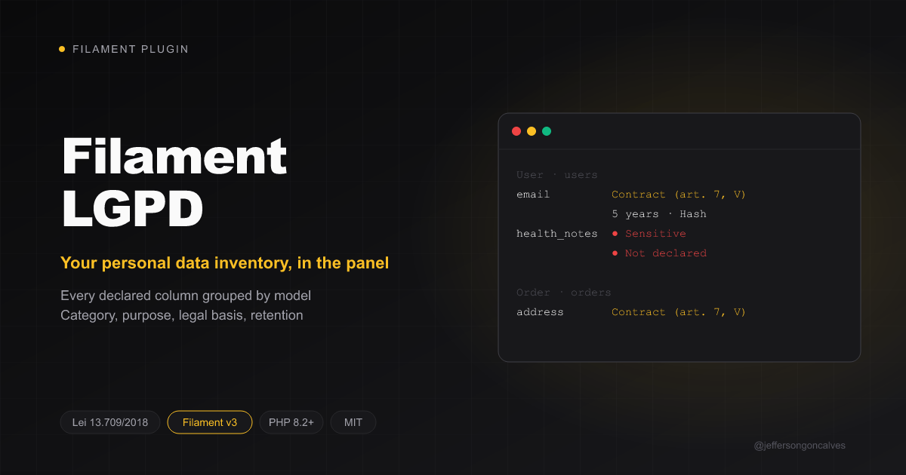

<div class="filament-hidden">



</div>

# Filament LGPD

[](https://packagist.org/packages/jeffersongoncalves/filament-lgpd)
[](https://github.com/jeffersongoncalves/filament-lgpd/actions?query=workflow%3Atests+branch%3A1.x)
[](https://github.com/jeffersongoncalves/filament-lgpd/actions?query=workflow%3A"Fix+PHP+code+styling"+branch%3A1.x)
[](https://packagist.org/packages/jeffersongoncalves/filament-lgpd)
[](LICENSE.md)

A personal data inventory page for your Filament panel, built on [laravel-lgpd](https://github.com/jeffersongoncalves/laravel-lgpd). It lists every column you declared with `#[PersonalData]`, grouped by model, with its category, purpose, legal basis, retention and anonymization strategy. It is the starting point of the record of processing activities (ROPA, LGPD art. 37).

## Features

- One card per model in `lgpd.models`, one row per declared column.
- Sensitive data (art. 5, II) highlighted.
- Columns without a legal basis flagged as "Not declared".
- 19 languages.

## Compatibility

| Plugin Version                                                      | Filament |
|---------------------------------------------------------------------|----------|
| [1.x](https://github.com/jeffersongoncalves/filament-lgpd/tree/1.x) | 3.x      |
| [2.x](https://github.com/jeffersongoncalves/filament-lgpd/tree/2.x) | 4.x      |
| [3.x](https://github.com/jeffersongoncalves/filament-lgpd/tree/3.x) | 5.x      |

## Installation

You can install the package via composer:

```bash
composer require jeffersongoncalves/filament-lgpd:"^1.0"
```

Declare your personal data and register the models as described in [laravel-lgpd](https://github.com/jeffersongoncalves/laravel-lgpd#usage).

## Usage

```php
use JeffersonGoncalves\Filament\Lgpd\LgpdPlugin;

public function panel(Panel $panel): Panel
{
    return $panel
        ->plugins([
            LgpdPlugin::make()
                ->navigationGroup('LGPD')             // default: no group
                ->navigationSort(1)
                ->navigationIcon('heroicon-o-finger-print')
                ->slug('personal-data-inventory'),
        ]);
}
```

All fluent methods are optional. The page is read-only: the inventory lives in your code, next to the models.

> The page has no authorization of its own: register it only on panels whose users may see it, or override `canAccess()` in a subclass.

## Related plugins

- [filament-lgpd-dsar](https://github.com/jeffersongoncalves/filament-lgpd-dsar): data subject requests (art. 18).

## Testing

```bash
composer test
```

## Changelog

Please see [CHANGELOG](CHANGELOG.md) for more information on what has changed recently.

## Contributing

Please see [CONTRIBUTING](.github/CONTRIBUTING.md) for details.

## Security Vulnerabilities

Please review [our security policy](../../security/policy) on how to report security vulnerabilities.

## Credits

- [Jefferson Gonçalves](https://github.com/jeffersongoncalves)
- [All Contributors](../../contributors)

## License

The MIT License (MIT). Please see [License File](LICENSE.md) for more information.
